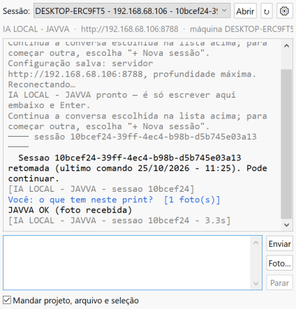
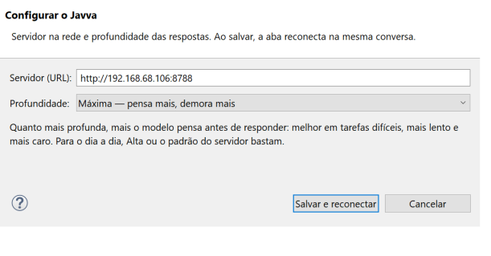
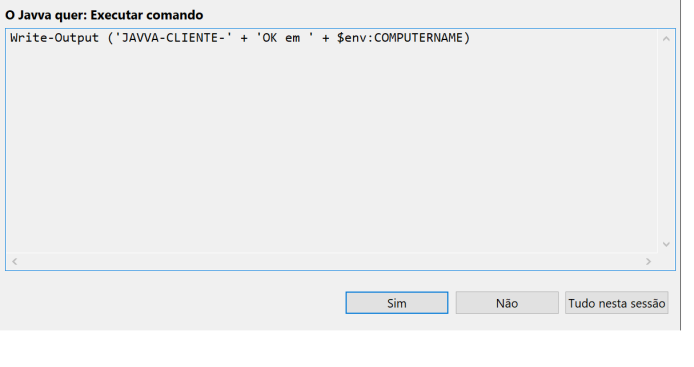

# IA LOCAL - JAVVA

Assistente de IA da rede local. **O cérebro roda num container** (servidor) e
**as mãos ficam no seu computador**. Pelo Eclipse ou pelo `javva.bat` você
conversa, manda fotos e prints, e o Javva **executa tarefas na sua máquina**
(comando, ler e gravar arquivo, listar pasta). Antes de cada execução ele
pergunta **"Permitir?"**.

```
 Eclipse (plugin) ─┐                       ┌──────────── container javva :8787 ───────────┐
                   ├── WebSocket /sessao ──►│ modelo + 4 ferramentas (executar, ler_arquivo, │
 javva.bat ────────┘                       │ escrever_arquivo, listar_pasta)                │
        ▲                                  └──────────────┬───────────────────────────────┘
        │   "execute X"  (a ferramenta repassa ao cliente) │  Mongo: máquinas, sessões, uso
        └──── Permitir? → roda aqui → resultado de volta ──┘
```

| Peça | O que é | Onde |
|---|---|---|
| **Container** | servidor FastAPI + agente; serve também os clientes para download | [`Dockerfile`](Dockerfile), [`app/`](app) |
| **Plugin Eclipse** | aba "IA LOCAL - JAVVA" dentro do `eclipse.exe` | [Release](../../releases/latest) → `javva-eclipse.zip` · fonte em [`eclipse/`](eclipse) |
| **javva.bat** | cliente de console (Windows, nada para instalar) | [`cliente/javva.bat`](cliente/javva.bat) |

---

## 1. Subir o container (servidor)

Pré-requisitos: Docker com Compose, e uma conta do modelo (token da sua
assinatura **ou** chave de API — veja [Conta](#conta-do-modelo)).

### Servidor novo (Javva + Mongo juntos)

```bash
git clone https://github.com/thiagojosecorreiaaraujo-code/javva.git
cd javva
cp javva.env.example javva.env      # preencha CLAUDE_CODE_OAUTH_TOKEN ou ANTHROPIC_API_KEY
docker compose -f docker-compose.avulso.yml up -d --build
curl http://127.0.0.1:8787/saude
```

Resposta esperada: `{"javva":"0.2.0", ..., "mongo":true, "conta_claude":true}`.

### Servidor da casa (Mongo já existente na rede `lupa_net`)

[`docker-compose.yml`](docker-compose.yml) entra na rede Docker externa
`lupa_net`, onde já está o Mongo. Duplo clique em [`configurar.bat`](configurar.bat): ele gera o token
da conta, grava `javva.env` (via [`gerar_env.py`](gerar_env.py)) e roda
`docker compose up -d --build`.

### Liberar a porta para a rede

No Windows do servidor (terminal de administrador):

```bat
netsh advfirewall firewall add rule name="Javva 8787" dir=in action=allow protocol=TCP localport=8787 remoteip=192.168.68.0/24
```

Detalhes do container (variáveis, volumes, rotas, administração):
[docs/container.md](docs/container.md).

---

## 2. Instalar o plugin no Eclipse

1. Baixe o **`javva-eclipse.zip`**: da [Release mais nova](../../releases/latest)
   ou do próprio servidor em `http://<servidor>:8787/javva-eclipse.zip`.
   **Não precisa descompactar.**
2. No Eclipse: **Help → Install New Software… → Add… → Archive…** → escolha o
   zip → Name: `IA LOCAL - JAVVA` → **Add**.
3. Marque **IA LOCAL** → **Next** → **Next** → aceite → **Finish**.
4. Se aparecer **Trust** (conteúdo sem assinatura): marque e clique
   **Trust Selected**.
5. Reinicie o Eclipse. Abra pelo menu **IA LOCAL → Abrir o Javva** ou pelo
   botão azul "J" da barra.

Funciona em Eclipse rodando com Java 17 ou mais novo (2022 em diante). Passo a passo com
problemas comuns: [docs/eclipse.md](docs/eclipse.md).

### Usar



- **Escreva embaixo e tecle Enter.** `Shift+Enter` quebra linha.
- **Sessão**: escolha na lista do alto e clique **Abrir** para retomar uma
  conversa; "+ Nova sessão" começa outra. **↻** reconecta. **Parar**
  interrompe o comando que está rodando.
- **Print Screen / imagem copiada**: `Ctrl+V` na caixa de texto (ou botão
  direito → *Colar imagem*). A imagem vai junto com a próxima mensagem.
  **Foto…** anexa arquivos de imagem.
- **Mandar projeto, arquivo e seleção**: com a caixa marcada, o Javva recebe
  o projeto aberto, o arquivo do editor e o trecho selecionado.
- **⚙ Configurar**: servidor (URL) e **profundidade** das respostas. Ao salvar,
  a aba reconecta **na mesma conversa**.

  

- **Permitir?**: toda ação na sua máquina aparece antes de rodar.
  *Sim*, *Não* ou *Tudo nesta sessão*.

  

Também em **Window → Preferences → IA LOCAL - JAVVA**.

---

## 3. Cliente de console (`javva.bat`)

Em qualquer PC Windows da rede: baixe `http://<servidor>:8787/javva.bat` e dê
dois cliques. Outro servidor: `set JAVVA_URL=http://outro:8787` antes de
rodar.

- `javva` abre a conversa (menu de sessões com as setas).
- `javva "pergunta"` responde uma vez e sai.
- Foto: cole ou arraste o arquivo na janela. `/sair` encerra.
- O `.bat` se atualiza sozinho quando o servidor tem versão nova.

---

## Conta do modelo

O container precisa de **uma** destas variáveis em `javva.env`:

| Variável | Quando usar |
|---|---|
| `CLAUDE_CODE_OAUTH_TOKEN` | token da **sua** assinatura (`claude setup-token`, começa com `sk-ant-oat`). Só para **você**, nas suas máquinas. |
| `ANTHROPIC_API_KEY` | chave de API do Console. **Obrigatória se outras pessoas forem usar**: os termos não permitem dividir assinatura. |

`javva.env` está no `.gitignore` e **nunca** deve ir para o repositório.

---

## Desenvolvimento

| Tarefa | Comando |
|---|---|
| Prova do servidor + `javva.bat` sem gastar crédito (API falsa) | `docker compose -f docker-compose.teste.yml up -d --build` → `python testes/prova.py` |
| Gerar o plugin (sem Maven/Tycho: usa o javac e o p2 do Eclipse instalado) | `python eclipse/construir.py` → `cliente/eclipse/` + zip |
| Prova do plugin dentro do `eclipse.exe` real | `python testes/eclipse/prova_eclipse.py` |

Estrutura:

```
app/            servidor (javva.py rotas, cerebro.py agente, banco.py Mongo, admin.py)
cliente/        o que o container serve: javva.bat, eclipse/ (update site p2 + zip)
eclipse/        fonte do plugin (br.lupa.javva), feature, category.xml, construir.py
testes/         provas automáticas (API falsa, console real, eclipse.exe real)
docs/           container.md, eclipse.md, notas-tecnicas.md, imagens
```
